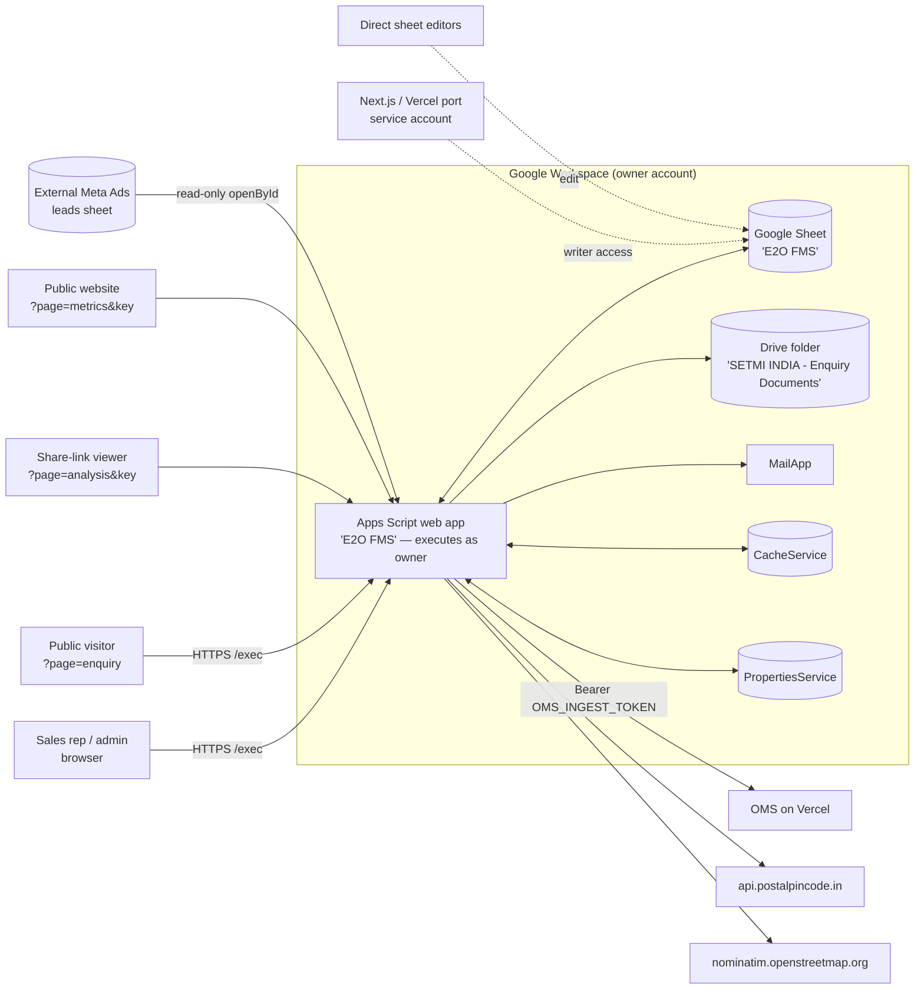
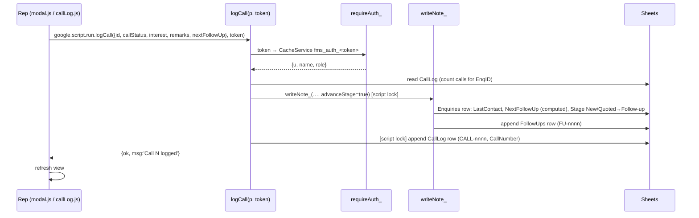
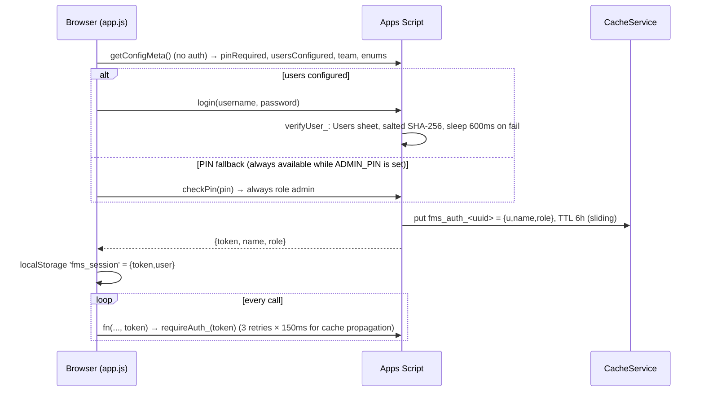

# 02 — Architecture

## System context



Solid lines are verified in source. Dotted lines come from Drive permissions and data patterns
(see 01).

## Runtime model [V]

- **Container-bound script.** `SpreadsheetApp.getActiveSpreadsheet()` is used everywhere, and the
  Drive permissions of the script and the workbook are identical. All server files share one
  global scope.
- **Web app manifest** (`src/appsscript.json`): `executeAs: USER_DEPLOYING`,
  `access: ANYONE_ANONYMOUS`, V8, time zone Asia/Kolkata. Every request runs **with the owner's
  Google permissions**, whoever the caller is. Authentication is implemented entirely inside the
  app (see 07).
- **Routing**: `doGet(e)` in `Code.js` reads `?page=`:

  | `page` | Response |
  |---|---|
  | `metrics` | `publicMetricsJson_(key)` → JSON (ContentService) |
  | `enquiry` | `Enquiry.html` (public form) |
  | `analysis` | `Share.html` if `key` matches `ANALYSIS_SHARE_KEY_`, else "This link is not valid." |
  | *(default / `admin`)* | `Index.html` (main SPA) |

  All HTML outputs set `XFrameOptionsMode.ALLOWALL`, so the pages can be embedded in any site.
- **Client → server**: the client calls `google.script.run.withSuccessHandler(..).fn(args…, token)`.
  Apps Script exposes **every top-level function whose name does not end in `_`**. In Deployment A
  that is 94 functions, listed in [04](04_CODEBASE_REFERENCE.md#exposed-api-surface).
- **Templates**: `Index.html` pulls in 21 partials with `<?!= include('name') ?>`. Each partial is
  a `.html` file wrapping `<script>` (JS) or `<style>` (css).

## Component diagram

```mermaid
flowchart TB
  subgraph Client["Browser (HtmlService IFRAME sandbox)"]
    idx[Index.html shell + gates]
    app[app.js<br/>session, refreshAll, tabs]
    utils[utils.js / dataTable.js / css]
    views[dashboard, dashboardCharts, followup, availableLeads,<br/>pipeline, customer, newEnquiry, pending, bulkImport,<br/>callLog, modal, omsOrder, reports, teamPerformance,<br/>users, mapAnalytics, analysis]
    idx --> app --> views
    views --> utils
  end
  subgraph Server["Apps Script (single global scope)"]
    code[Code.js — config, routing, auth, users, team,<br/>customers, enquiries, pending, stage, follow-up engine,<br/>cached readers, dashboard, reports, digest, menu tools]
    call[CallLog.js — structured calls]
    ana[Analysis.js — analysis rows, share link, customers list]
    map[MapAnalytics.js — geo / zone analytics]
    meta[MetaLeadsImport.js — Meta Ads import]
    omsb[OmsBridge.js — OMS orders]
    pubm[PublicMetrics.js — metrics feed]
    geo[PincodeGeo.js — ~19k pincode→lat/lng table]
  end
  views -->|google.script.run| code & call & ana & map & meta & omsb
  call --> code
  ana --> code
  map --> code & geo
  meta --> code
  omsb --> code
  pubm --> code
```

## Request lifecycle: example "Log a call"



## Data access pattern [V]

- **Header-driven columns.** Almost every reader and writer builds a map from header text to
  index (`colMapFromRow_`), so inserting columns in the sheet is mostly safe. Exceptions that
  depend on **position**:
  - the Team sheet (`d[i][0]`, `d[i][1]`)
  - the Archive copy and restore paths (row arrays are copied positionally; see BUG-002)
  - `submitBulkPendingFromRows` and `savePendingRow_`, which size rows by `PEND_HEADERS.length`
- **Full-sheet reads.** Lists read `getDataRange().getValues()` and filter in memory. The
  Enquiries, CallLog and FollowUps reads are cached in CacheService (`cachedSheetRows_`):
  - 80–150 rows per chunk, TTL 90 s
  - writers invalidate the cache by bumping a version key
- **Writes.** Most writes rewrite the whole row (`getRange(r,1,1,row.length).setValues([row])`)
  from a snapshot taken earlier in the same call. Without a lock, two writers on the same row can
  lose an update (BUG-004).
- **Locks.** `LockService.getScriptLock()` (15 s wait) protects ID generation in `addEnquiry`,
  claim/transfer, pending submit, `writeNote_`, archive/restore and bulk inserts. `editEnquiry`,
  `moveStage`, `deleteEnquiry`, `editCustomer`, approve/reject/update pending take no lock.
- **IDs.** `PREFIX + zero-padded (max existing + 1)`, padded to 4 digits. IDs wrap after 9999
  (BUG-005). Prefixes: `SETMI-ENQ-`, `CUST-`, `PEND-`, `FU-`, `CALL-`.

## Authentication flow



Server-side callers use `INTERNAL_BYPASS_`, a UUID generated fresh in each execution, to call
authenticated functions internally.

## Deployment architecture

See [06](06_DEPLOYMENT_AND_CONFIGURATION.md) and [13](13_ENVIRONMENTS_AND_DEPLOYMENT.md). There is
one script project, one workbook, and two live `/exec` deployments. There is no staging
environment and no source control integration.
