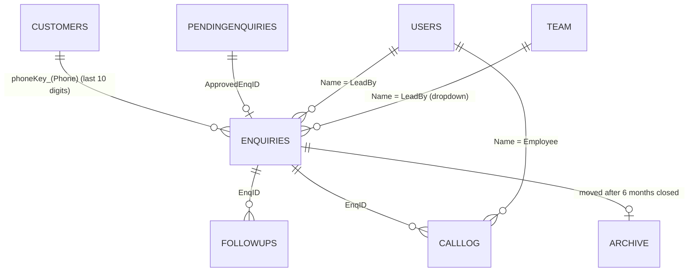

# 03 — Google Sheets Data Dictionary

**Workbook:** "E2O FMS" (`1AjeB8fV…NVo`), owned by the SETMI INDIA owner account.

**Inspected:** 2026-10-20, read-only via the Sheets API (headers, row counts, ID columns, number
formats, filters, validations). No customer values are reproduced here.

## Workbook-level facts [V]

| Item | Finding |
|---|---|
| Tabs | 15: Enquiries, Archive, Report Sep 2026, Reconciliation Results 2026-09-15 13:58, Users, Report Aug 2026, PendingEnquiries, CallLog, Orders, OrderItems, Report Jul 2026, Customers, Team, FollowUps, Report Jun 2026 |
| Formulas | None in the sampled data rows. One PendingEnquiries Phone cell is stored as a *formula* `+91…`, the known "#ERROR!" pattern (see BUG-016) |
| Data validation (dropdowns) | **None** on the sampled rows. Enums are enforced only by app code |
| Named ranges / protected ranges / conditional formats | None |
| Filters | Basic filters on Enquiries, PendingEnquiries, CallLog, Customers, FollowUps. **Enquiries is a Sheets *Table*** (`tableId 1576087055`) and currently has an active filter that hides some LeadBy/LastContact values (a user's view, not app logic) |
| Number formats | Phone, Pincode and free-text columns are forced to Plain Text (`@`) by `forcePhoneColumnsText_` / `forceTextColumns_`. Date columns use `yyyy-mm-dd`; CreatedAt uses DATE_TIME |

## Sheet roles

| Sheet | Role | Primary key | Written by |
|---|---|---|---|
| Enquiries | **Transaction (core)**: one row per enquiry/lead | `EnqID` | addEnquiry, editEnquiry, moveStage, deleteEnquiry (soft), claim/transfer, writeNote_, bulkInsertEnquiries_, menu fixers, OMS bridge, *external Next.js app [H]* |
| PendingEnquiries | **Transaction (intake queue)**: leads awaiting review | `PendingID` | savePendingRow_, submitBulkPendingFromRows, approve/reject/update, *external Meta import [H]* |
| Customers | **Master**: one row per phone number | `CustID` (+ unique `Phone` by convention) | upsertCustomer_, editCustomer, upsertCustomerOverwrite_, backfillCustomers_ |
| FollowUps | **Activity log**: every note or call outcome | `FollowUpID` | writeNote_ |
| CallLog | **Activity log**: structured calls 1..N per enquiry | `CallLogID` | logCall |
| Users | **Config/security**: app logins | `Username` | addUser, changePassword, setUserActive, adminResetPassword, setUserRole |
| Team | **Config/master**: "Lead By" roster | `Name` | addTeamMember, removeTeamMember, setupSheets seed |
| Archive | **Cold storage** for closed enquiries older than 6 months | `EnqID` | archive/restore menu tools (currently **empty**) |
| Report *Mon yyyy* | **Report output**, regenerated per month | n/a | generateReportSheet (deletes and recreates the sheet) |
| Reconciliation Results … | **One-off output** of a temporary diagnostic | n/a | reconcileDataCore_ |
| Orders, OrderItems | **Orphaned**: header only, 0 rows, no code references them | `OrderID` / `OrderItemID` | none [V]. [H] left over from a removed `Orders.js` (mentioned in a MapAnalytics comment) |

## Enquiries (40 columns, 4,024 rows incl. 7 blank rows)

Physical order (A→AN) [V]. "Code" means the constant `ENQ_HEADERS`; the physical order **differs**
from the constant (ClaimedAt/TransferTo were appended later, and ShipmentWeight was moved).

| # | Column | Type / format | Meaning, rules | Set by |
|---|---|---|---|---|
| A | EnqID | text `SETMI-ENQ-nnnn` | PK. max+1, 4-digit pad. 0 duplicates on 2026-10-20 | addEnquiry, bulkInsertEnquiries_ |
| B | CreatedAt | datetime | row creation | same |
| C | EnqDate | date | business date of the enquiry (form, default today) | addEnquiry |
| D | Customer | text (@) | contact name (**required**) | form / edit |
| E | Company | text (@) | | |
| F | Phone | text (@) | contact phone; join key to Customers via last 10 digits (`phoneKey_`) | |
| G | Email | text (@) | client-side format check only | |
| H | GST | text | GSTIN, client-side regex | |
| I | Pincode | text (@) | 6 digits. Drives postalpincode autofill and map placement | |
| J | District | text | from the pincode lookup | |
| K | State | text | free text, normalized at read time by `normalizeState_` | |
| L | City | text | area/post office or typed city | |
| M | Source | enum `CONFIG.SOURCES` | default "Other" | |
| N | Requirement | text (@) | product + "— Qty: …". Parsed by `analysisProduct_` | |
| O | EstValue | number | `num_()` parsed | |
| P | Stage | enum `STAGES` | New/Quoted/Follow-up/Won/Lost/Dispatched/Closed. **Not validated by `moveStage`** (BUG-009). Live: New 1438, Follow-up 2086, Quoted 1, Won 35, Lost 431, Dispatched 4, Closed 22 | moveStage, writeNote_ |
| Q | Priority | enum Hot/Warm/Cold or blank | blank = unclaimed, or cleared on a terminal stage. Live: Cold 2727, Warm 560, Hot 27, blank 710 | claim, edit, moveStage |
| R | LeadBy | text | owning rep (**must equal the user's `Name`** for rep scoping). Blank = on Available Leads | claim, transfer, edit |
| S | QuoteNo | text | | moveStage(Quoted) |
| T | QuoteAmount | number | | (no current writer found) [?] |
| U | QuoteDate | date | | moveStage(Quoted) |
| V | NextFollowUp | date | planned next call: `computeNextFollowUp_(Priority, LastContact)`, working days, Sunday skipped (Hot 1 / Warm 2 / Cold 6). Cleared on Won/Lost/Dispatched/Closed | many |
| W | LastContact | date | last actual contact | writeNote_, moveStage |
| X | OrderValue | number | used in Won-revenue KPI | (no current writer found) [?] |
| Y | LostReason | text | | moveStage(Lost) |
| Z | DispatchDate | date | | moveStage(Dispatched) |
| AA | DispatchInfo | text | | moveStage(Dispatched) |
| AB | FeedbackRating | number | | moveStage(Closed) |
| AC | FeedbackNote | text | | moveStage(Closed) |
| AD | Notes | text (@) | append-only log `"| yyyy-mm-dd: note"`; also carries the `MetaLeadID:<id>` dedup tag | |
| AE | Active | YES/NO | soft delete (`deleteEnquiry`). Live: YES 4004, NO 13, blank 7 | |
| AF | PhotoUrl | URL | Drive link of the PDF attached at intake (shared *anyone with link*) | approve |
| AG | ClaimedAt | datetime | header auto-added on first claim | claimEnquiry, acceptTransfer |
| AH | TransferTo | text | pending transfer target rep | proposeTransfer |
| AI | ShipmentWeight | number or blank (kg) | | moveStage(Dispatched), edit |
| AJ | Qty | number | metres/units. Grade input | add / edit |
| AK | Timeline | enum Immediate/Fortnight/Just Exploring | Grade input | |
| AL | Grade | A/B/C | `gradeFor_(Qty, Timeline)` | add / edit |
| AM | Escalation | enum Proprietor/Shop Floor | | edit |
| AN | InvoiceNo | text | **required** to move to Won (unless the OMS bridge sets `skipInvoice`) | moveStage(Won) |
| — | OMSOrderID | text | header **auto-added on first OMS order** (not present yet) | recordOrderToOms |

## Archive (38 columns, 0 data rows) [V]

The headers equal `ENQ_HEADERS` in **constant order** (no ClaimedAt/TransferTo; ShipmentWeight
sits at position 28). This **does not match** Enquiries' physical order, and the archive/restore
code copies rows by position. See **BUG-002**. The grid is 38 columns wide, Enquiries is 40.

## PendingEnquiries (24 columns, 341 rows) [V]

`PendingID, CreatedAt, SubmittedBy, Customer, Company, Phone, Email, GST, Pincode, District, State,
City, Source, Priority, LeadBy, EstValue, Requirement, Notes, PhotoUrl, Status, ApprovedEnqID,
ReviewedBy, ReviewedAt, RejectReason`

- Status: Pending 109 / Approved 230 / Rejected 2.
- **Missing `Qty` and `Timeline`**, which the code's `PEND_HEADERS` defines. Intake writes them
  only if the column exists, so those values are silently dropped (**BUG-006**).
- `SubmittedBy` is mostly "Meta Ads auto-import", a value this code never writes (external writer [H]).
- `ReviewedBy` is blank on about 170 of the 232 reviewed rows (**BUG-017**).
- Some CreatedAt values are ISO strings rather than dates (external writer [H]).

## Customers (14 columns, 3,084 rows)

`CustID, CreatedAt, Name, Company, Phone, Email, GST, Pincode, District, State, City, Source, Notes, Active`

- PK `CUST-nnnn` (max 3085, no duplicates). Phone uniqueness (last 10 digits) is enforced only by
  `upsertCustomer_`'s scan.
- An enquiry edit **overwrites** the customer row and cascades the change to every enquiry with
  the same old phone (`upsertCustomerOverwrite_` → `syncEnquiriesForCustomer_`).

## FollowUps (9 columns, 4,317 rows)

`FollowUpID, CreatedAt, EnqID, Customer, Mode, Outcome, NextFollowUp, By, Note`

- FK `EnqID` → Enquiries.
- `Mode` = Call or Note.
- **2 duplicate FollowUpIDs** (`FU-0408`, `FU-0511`) [V] (BUG-003).

## CallLog (11 columns, 2,739 rows)

`CallLogID, CreatedAt, EnqID, Customer, CallNumber, CallDate, Employee, Remarks, NextFollowUp, CallStatus, Interest`

- CallStatus enum: Connected / Not Connected / Busy / Switched Off / No Answer.
- Interest (only when Connected): Interested / Maybe / Thinking / Not Interested.
- `Employee` is free text from the client and is compared to the user's `Name` for rep scoping.
- **34 duplicate CallLogIDs** [V] (BUG-003).

## Users (6 columns, 5 rows) — sensitive

`Username, Name, PassHash, Role, Active, CreatedAt`

- `PassHash` = `<uuid salt>:<sha256(salt:password)>`.
- `Name` must exactly equal the `LeadBy` / `Employee` strings for rep scoping to work.
- **Anyone with edit access to the workbook can read the hashes or add an admin row** (SEC-03).

## Team (2 columns, 12 rows)

`Name, Active`

Read **positionally** (`d[i][0]`, `d[i][1]`). It drives the Lead By dropdowns and the
`addEnquiry` default owner (first active name, unless the lead is left unclaimed).

## Relationships

All relationships are **by convention only**. There are no foreign-key checks, and the
name-based joins (LeadBy / Employee / By) break silently if a user's display `Name` is changed.

## Data integrity considerations

1. Header text is the contract. Renaming a header (for example `LeadBy`) breaks every reader. The
   position of columns does not matter, except in Archive, Team and the bulk pending writers.
2. The second writer (Next.js app) must be considered for any schema change [H].
3. Enum values are not validated in the sheet. Typed edits in the sheet bypass the app's rules.
4. Phone is the customer identity. Two customers sharing a phone merge, and a phone edit cascades
   to every matching enquiry.
5. 7 blank rows exist inside the Enquiries table (no EnqID). Readers skip them.
