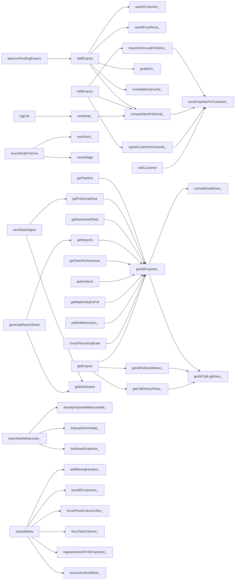

# 04 — Codebase Reference

The source is `src/`, an export of the production project "E2O FMS" taken on 2026-10-20. Apps
Script loads every server file into **one global scope**, so a constant or function in any file
is visible from all the others.

## File inventory

### Server (`.js`, stored as `.gs` in Apps Script)

| File | Lines | Purpose | External services / side effects |
|---|---|---|---|
| `Code.js` | 3,134 | Core. CONFIG/enums/headers; India state normalization; `doGet` routing; setup/migration; helpers; follow-up scheduling; spreadsheet menu and ~20 maintenance/diagnostic tools; archive; read-only audit; WhatsApp message builders; auth (PIN, users, sessions); team; customers; enquiries CRUD; claim/transfer; pending approvals; bulk import; stage moves; follow-up engine (`writeNote_`); cached readers; pipeline/follow-ups/dashboard/charts/reports/team performance; report sheet; daily digest | SpreadsheetApp, CacheService, LockService, PropertiesService, DriveApp (PDF uploads, sharing), MailApp, UrlFetchApp (Nominatim), ScriptApp (triggers) |
| `CallLog.js` | 121 | Structured calls (Call 1…N, default 6), call dashboard | Sheets (CallLog, via writeNote_ also Enquiries + FollowUps) |
| `Analysis.js` | 84 | Data Analysis rows (PII-free), public share key, customers list | Sheets (cached reads) |
| `MapAnalytics.js` | 267 | Geo/zone analytics; district geocoding with a permanent cache | UrlFetchApp → Nominatim; PropertiesService cache |
| `MetaLeadsImport.js` | 213 | Imports Meta Ads leads from an external sheet straight into Enquiries; 30-min trigger setup | SpreadsheetApp.openById (external), UrlFetchApp → api.postalpincode.in, ScriptApp |
| `OmsBridge.js` | 107 | Creates/reads OMS orders, PI sent, payments | UrlFetchApp → `OMS_URL` with Bearer `OMS_INGEST_TOKEN` |
| `PublicMetrics.js` | 60 | `?page=metrics` counts-only JSON | PropertiesService (`PUBLIC_METRICS_KEY`) |
| `PincodeGeo.js` | 3 (513 KB) | Generated `PINCODE_LATLNG_` table (~19k pincodes, GeoNames CC-BY 4.0) | none |
| `appsscript.json` | 13 | Manifest: V8, Asia/Kolkata, web app USER_DEPLOYING / ANYONE_ANONYMOUS, Stackdriver logging | — |

### HTML templates and client partials

| File | Lines | Role | Server functions called |
|---|---|---|---|
| `Index.html` | 583 | Main SPA shell: login/PIN/forgot gates, 13 tabs, view containers, `include()` of all partials | getConfigMeta |
| `Enquiry.html` | 269 | **Public** field-capture form (`?page=enquiry`) | getConfigMeta, checkPhoneDuplicate, submitFieldEnquiry |
| `Share.html` | 24 | **Public** analysis share page | (via analysis.js) getAnalysisShared |
| `app.js.html` | 374 | Session (localStorage `fms_session`), gates, tab switching, `refreshAll`, auth error handling | login, checkPin, requestPasswordReset, whoAmI, getFollowUpBadgeCounts |
| `utils.js.html` | 85 | `esc`, `badge`, `toast`, phone/email/GST/pincode validators, pincode autofill (browser → api.postalpincode.in) | — |
| `dataTable.js.html` | 294 | Generic sortable/filterable table, column toggles (localStorage) | — |
| `dashboard.js.html` | 113 | KPIs | getDashboardData |
| `dashboardCharts.js.html` | 105 | ApexCharts rendering | — |
| `followup.js.html` | 90 | Follow-ups due (overdue / today / upcoming) | getFollowUpsDue |
| `availableLeads.js.html` | 116 | Unclaimed leads, claim, Meta import button | getUnclaimedEnquiries, claimEnquiry, logCall, importMetaLeadsNow |
| `pipeline.js.html` | 209 | Pipeline list + filters, incoming transfers | getPipeline, getIncomingTransfers |
| `customer.js.html` | 114 | Customers list/edit, team roster edits | getCustomers, addCustomer, editCustomer, addTeamMember, removeTeamMember |
| `newEnquiry.js.html` | 154 | New Enquiry form (→ Pending), duplicate check, autofill, PDF attach | checkPhoneDuplicate, getCustomerByPhone, getEnquiryLink, submitPendingEnquiry |
| `pending.js.html` | 180 | Pending Approvals review | getPendingEnquiries, approvePendingEnquiry, rejectPendingEnquiry, updatePendingEnquiry |
| `bulkImport.js.html` | 261 | CSV/Excel import, parsed in the browser (SheetJS) | submitBulkPendingFromRows |
| `callLog.js.html` | 111 | Call logging UI + call KPIs | logCall, getCallDashboard |
| `modal.js.html` | 466 | Enquiry detail/edit modal, stage moves, transfer, WhatsApp buttons, **prefilled "Order FMS" Google Form link** | getEnquiry, editEnquiry, moveStage, deleteEnquiry, proposeTransfer, changePassword |
| `omsOrder.js.html` | 114 | OMS order panel | getOmsProducts, recordOrderToOms, getOmsOrder, omsMarkPiSent, omsRecordPayment |
| `reports.js.html` | 64 | Reports + "export to sheet" | getReports, generateReportSheet |
| `teamPerformance.js.html` | 41 | Leaderboard | getTeamPerformance |
| `users.js.html` | 106 | User admin | listUsersForAdmin, addUser, setUserActive, adminResetPassword, setUserRole |
| `mapAnalytics.js.html` | 279 | Leaflet map + zone tables | getMapAnalyticsFull |
| `analysis.js.html` | 389 | Data Analysis tab (client-side filters/aggregation) | getAnalysis, getAnalysisShared, getCustomersList |
| `css.html` | 421 | All styles | — |

**CDN dependencies:**
- `cdn.jsdelivr.net/npm/apexcharts` (**unversioned**, so it always loads the latest)
- `leaflet@1.9.4`
- Google Fonts
- `xlsx@0.18.5` (SheetJS), loaded on demand by `bulkImport.js`. This is the last npm release; it has published advisories (CVE-2023-30533, CVE-2024-22363) that are fixed only in later releases on SheetJS's own CDN (SEC-12)

## Key shared functions (change with care)

| Function | Used by | Notes |
|---|---|---|
| `requireAuth_(token)` | every authenticated endpoint | Returns `{u,name,role}`. Fully **open** if no PIN *and* no users are configured |
| `requireOwnLeadOrAdmin_(me, leadBy)` | editEnquiry, moveStage, deleteEnquiry, OMS actions | rep ⇔ `LeadBy === me.name` |
| `getAllEnquiries_()` | dashboard, pipeline, follow-ups, reports, analysis, map, metrics, audit, duplicate check… | Cached 90 s. Returns **Active≠NO rows only** |
| `cachedSheetRows_()` | getAllEnquiries_, getAllCallLogRows_, getAllFollowUpRows_ | The version key is bumped by `invalidate*Cache_()`. A writer that forgets to invalidate serves stale data for up to 90 s |
| `writeNote_(p, advanceStage)` | logCall | Updates LastContact/NextFollowUp/Stage and appends a FollowUps row |
| `computeNextFollowUp_` / `addWorkingDays_` | add/claim/edit/moveStage/writeNote_/recalculate | The business rule for call cadence. Covered by unit tests |
| `addEnquiry(p, token)` | approvePendingEnquiry (internal bypass) | No UI calls it directly any more (all intake goes through Pending), but it is still exposed |
| `colMapFromRow_` / `colMap_` | everywhere | Header-name → index |
| `newIdFromRows_` | all ID generation | 4-digit pad; wraps after 9999 (BUG-005) |
| `upsertCustomer_` / `upsertCustomerOverwrite_` / `syncEnquiriesForCustomer_` | add/edit enquiry, customers | Phone-keyed cascade |
| `normalizeState_` / `fuzzyNormalizeState_` | charts, map, analysis, fixers | Covered by unit tests |

## Function dependency map (main paths)

## Exposed API surface

Deployment A's served page lists **94 callable server functions**. That is exactly the set of
non-underscore top-level functions in `src/` [V: extracted from the live page on 2026-10-20 and
compared to the source]. Deployment B exposes **44**, including two that no longer exist in source
(`getMapAnalytics`, `getMapDrilldown`).

Functions exposed with **no authentication check** are listed in
[07 SEC-01](07_SECURITY_AND_RISKS.md#sec-01). Read that before adding any new top-level function:
**if a function name does not end in `_`, it can be called from the internet.**

## Implementation notes and fragile spots (to investigate, not confirmed defects unless cross-referenced)

- Menu tools named `*FromMenu` call `SpreadsheetApp.getUi()`. That throws in a web-app context,
  but several of them **modify data before** their first `getUi()` call (for example
  `fixCityStateMixupFromMenu`, `importMetaLeadsFromMenu`).
- `CONFIG.ADMIN_EMAIL = Session.getActiveUser().getEmail()` is evaluated at load time. It is empty
  for most web-app callers (BUG-017).
- "TEMP" / "Delete after use" diagnostics are still deployed and exposed:
  `reconcileDataFromMenu`, `pushNotFoundToEnquiriesFromMenu`, `debugPhoneMatchFromMenu`,
  `debugRowStateFromMenu`, `debugStateSample_`.
- Comments are mostly English, and UI messages are Hinglish. Do not "fix" the message language
  without approval.
- Many comments refer to a Vercel/Next.js port (`web/lib/...`). That code is **not** in this repository.

## Full function inventory (generated)

Generated from `src/` on 2026-10-20.
- "Exposed" = callable through `google.script.run` (no trailing `_`).
- "Auth" = the function body calls `requireAuth_` (`token`) or a share/metrics key check (`key`)
  **directly**. `omsMarkPiSent` / `omsRecordPayment` authenticate through `omsOrderAction_`, and
  internal helpers are protected by their callers.
- "Sheets" lists only direct `sh_('KEY')` reads/writes.

#### `Analysis.js`

| Function | Line | Exposed | Auth | Sheets (direct `sh_()`) |
|---|---|---|---|---|
| `getAnalysis(token)` | 9 | public | token | — |
| `analysisKeyOk_(k)` | 17 | private | — | — |
| `getAnalysisShared(key)` | 18 | public | key | — |
| `analysisBuild_(me)` | 23 | private | — | — |
| `getCustomersList(token)` | 54 | public | token | — |
| `analysisProduct_(raw)` | 71 | private | — | — |

#### `CallLog.js`

| Function | Line | Exposed | Auth | Sheets (direct `sh_()`) |
|---|---|---|---|---|
| `getCallHistoryRows_(enqId)` | 23 | private | — | — |
| `getCallHistory(enqId, token)` | 33 | public | token | — |
| `logCall(p, token)` | 38 | public | token | CALL |
| `getCallDashboard(token)` | 88 | public | token | — |

#### `Code.js`

| Function | Line | Exposed | Auth | Sheets (direct `sh_()`) |
|---|---|---|---|---|
| `normalizeState_(raw)` | 93 | private | — | — |
| `levenshtein_(a, b)` | 103 | private | — | — |
| `canonStateNames_()` | 119 | private | — | — |
| `fuzzyNormalizeState_(raw)` | 133 | private | — | — |
| `doGet(e)` | 149 | public | key | — |
| `include(name)` | 170 | public | — | — |
| `setupSheets()` | 173 | public | — | — |
| `forcePhoneColumnsText_()` | 255 | private | — | — |
| `forceTextColumns_()` | 278 | private | — | — |
| `fixPhoneFormatting()` | 292 | public | — | — |
| `clearPriorityOnClosedStages()` | 325 | public | — | ENQ |
| `backfillCustomers_()` | 351 | private | — | CUST |
| `ss_()` | 388 | private | — | — |
| `sh_(k)` | 389 | private | — | — |
| `fmtDate_(d)` | 394 | private | — | — |
| `fmtNice_(d)` | 401 | private | — | — |
| `todayStr_()` | 402 | private | — | — |
| `monthKey_(d)` | 403 | private | — | — |
| `addDaysStr_(dateStr, n)` | 404 | private | — | — |
| `num_(v)` | 405 | private | — | — |
| `weightVal_(v)` | 409 | private | — | — |
| `phoneKey_(p)` | 410 | private | — | — |
| `calculateFollowupStatus(nextFollowUp)` | 413 | public | — | — |
| `gradeFor_(qty, timeline)` | 442 | private | — | — |
| `daysOverdue_(nextFollowUp)` | 451 | private | — | — |
| `isWorkingDay_(d)` | 457 | private | — | — |
| `addWorkingDays_(fromDateStr, n)` | 461 | private | — | — |
| `computeNextFollowUp_(priority, actualDateStr)` | 470 | private | — | — |
| `recalculateAllNextFollowUps()` | 477 | public | — | ENQ |
| `onOpen()` | 496 | public | — | — |
| `fixCityStateMixup_()` | 538 | private | — | ENQ |
| `fixCityStateMixupFromMenu()` | 573 | public | — | — |
| `cityStateCache_()` | 590 | private | — | — |
| `saveCityStateCache_(cache)` | 594 | private | — | — |
| `resolveCityState_(neededCities, budget)` | 598 | private | — | — |
| `findStateFromCityNeeded_()` | 628 | private | — | ENQ |
| `checkStateFromCityFromMenu()` | 646 | public | — | — |
| `fixStateFromCityFromMenu()` | 661 | public | — | ENQ |
| `findBugAutoAssignedLeads_()` | 687 | private | — | CALL, ENQ, FU, PEND |
| `checkBugAutoAssignedFromMenu()` | 722 | public | — | — |
| `fixBugAutoAssignedFromMenu()` | 731 | public | — | ENQ |
| `ensureArchiveSheet_()` | 753 | private | — | — |
| `archiveRefDate_(row, map)` | 765 | private | — | — |
| `findArchivableLeads_()` | 772 | private | — | ENQ |
| `reconcileDataFromMenu()` | 791 | public | — | — |
| `reconcileDataCore_(srcUrl, tgtUrl)` | 814 | private | — | — |
| `pushNotFoundToEnquiriesFromMenu()` | 935 | public | — | ENQ |
| `debugPhoneMatchFromMenu()` | 1003 | public | — | ENQ |
| `debugRowStateFromMenu()` | 1029 | public | — | ENQ |
| `checkDataCountsFromMenu()` | 1056 | public | — | ARCHIVE, ENQ |
| `checkArchivableFromMenu()` | 1067 | public | — | — |
| `archiveOldClosedLeadsFromMenu()` | 1074 | public | — | ENQ |
| `restoreLeadFromArchiveFromMenu()` | 1105 | public | — | ARCHIVE, ENQ |
| `restoreAllFromArchiveFromMenu()` | 1131 | public | — | ARCHIVE, ENQ |
| `auditRequiredHeaders_(issues)` | 1158 | private | — | — |
| `auditDuplicateIds_(issues)` | 1176 | private | — | — |
| `auditEnquiryValues_(issues, list, teamNames)` | 1192 | private | — | — |
| `buildWorkbookAuditReport_()` | 1202 | private | — | — |
| `runAuditFromMenu()` | 1231 | public | — | — |
| `debugStateSampleFromMenu()` | 1254 | public | — | — |
| `addMissingHeaders_(sheet, headers)` | 1268 | private | — | — |
| `colMap_(sheet)` | 1273 | private | — | — |
| `colMapFromRow_(headerRow)` | 1278 | private | — | — |
| `leadCol_(map)` | 1281 | private | — | — |
| `newId_(prefix, sheet, colIdx)` | 1282 | private | — | — |
| `newIdFromRows_(prefix, data, colIdx)` | 1286 | private | — | — |
| `waNum_(phone)` | 1294 | private | — | — |
| `rowToObj_(row, map)` | 1295 | private | — | — |
| `waWelcome_(e)` | 1308 | private | — | — |
| `waFollow_(e)` | 1318 | private | — | — |
| `waLinkWelcome_(e)` | 1327 | private | — | — |
| `waLinkFollow_(e)` | 1328 | private | token | — |
| `adminPin_()` | 1346 | private | — | — |
| `migrateAdminPinToProperties_()` | 1349 | private | — | — |
| `setAdminPin()` | 1353 | public | — | — |
| `getConfigMeta()` | 1362 | public | — | — |
| `sha256Hex_(str)` | 1375 | private | — | — |
| `hashPassword_(password)` | 1379 | private | — | — |
| `verifyPassword_(password, stored)` | 1383 | private | — | — |
| `listUsers_()` | 1390 | private | — | USERS |
| `anyUsersConfigured_()` | 1407 | private | — | — |
| `listUsersForAdmin(token)` | 1411 | public | token | — |
| `verifyUser_(username, password)` | 1416 | private | — | USERS |
| `addUser(username, name, password, role, token)` | 1437 | public | token | USERS |
| `addUserFromMenu()` | 1469 | public | — | — |
| `changePassword(currentPassword, newPassword, token)` | 1482 | public | token | USERS |
| `setUserActive(username, active, token)` | 1499 | public | token | USERS |
| `adminResetPassword(username, newPassword, token)` | 1513 | public | token | USERS |
| `setUserRole(username, role, token)` | 1529 | public | token | USERS |
| `login(username, password)` | 1556 | public | — | — |
| `requestPasswordReset(username)` | 1567 | public | — | — |
| `checkPin(pin)` | 1581 | public | token | — |
| `whoAmI(token)` | 1595 | public | token | — |
| `requireAuth_(token)` | 1598 | private | — | — |
| `getEnquiryLink()` | 1622 | public | — | — |
| `getTeam()` | 1625 | public | — | TEAM |
| `addTeamMember(name, token)` | 1631 | public | token | TEAM |
| `removeTeamMember(name, token)` | 1639 | public | token | TEAM |
| `upsertCustomer_(p)` | 1648 | private | — | CUST |
| `getCustomers(filter, token)` | 1682 | public | token | CUST |
| `addCustomer(p, token)` | 1705 | public | token | — |
| `editCustomer(p, token)` | 1710 | public | token | CUST |
| `syncEnquiriesForCustomer_(oldPhone, p)` | 1729 | private | — | ENQ |
| `upsertCustomerOverwrite_(oldPhone, p)` | 1754 | private | — | CUST |
| `checkPhoneDuplicate(phone)` | 1781 | public | — | — |
| `getCustomerByPhone(phone, token)` | 1792 | public | token | CUST |
| `addEnquiry(p, token)` | 1815 | public | token | ENQ |
| `getUnclaimedEnquiries(token)` | 1893 | public | token | — |
| `claimEnquiry(enqId, priority, token)` | 1901 | public | token | ENQ |
| `proposeTransfer(enqId, toRep, token)` | 1946 | public | token | ENQ |
| `acceptTransfer(enqId, token)` | 1983 | public | token | ENQ |
| `declineTransfer(enqId, token)` | 2016 | public | token | ENQ |
| `getIncomingTransfers(token)` | 2042 | public | token | — |
| `editEnquiry(p, token)` | 2048 | public | token | ENQ |
| `requireOwnLeadOrAdmin_(me, leadByValue)` | 2134 | private | — | — |
| `deleteEnquiry(id, token)` | 2144 | public | token | ENQ |
| `getDocFolder_()` | 2163 | private | — | — |
| `savePendingRow_(p, photoUrl)` | 2177 | private | — | PEND |
| `submitPendingEnquiry(p, token)` | 2207 | public | token | — |
| `submitFieldEnquiry(p)` | 2237 | public | — | — |
| `getPendingEnquiries(token)` | 2250 | public | token | PEND |
| `approvePendingEnquiry(pendingId, token)` | 2271 | public | token | PEND |
| `rejectPendingEnquiry(pendingId, reason, token)` | 2306 | public | token | PEND |
| `updatePendingEnquiry(p, token)` | 2328 | public | token | PEND |
| `submitBulkPendingFromRows(leads, token)` | 2366 | public | token | PEND |
| `moveStage(p, token)` | 2405 | public | token | ENQ |
| `writeNote_(p, advanceStage)` | 2454 | private | — | ENQ, FU |
| `cachedSheetRows_(cachePrefix, sheetKey, ttlSeconds, chunkSize, keep, mapRow)` | 2505 | private | — | — |
| `invalidateSheetCache_(cachePrefix)` | 2559 | private | — | — |
| `invalidateEnqCache_()` | 2567 | private | — | — |
| `getAllEnquiries_()` | 2568 | private | — | — |
| `invalidateCallCache_()` | 2576 | private | — | — |
| `getAllCallLogRows_()` | 2577 | private | — | — |
| `invalidateFuCache_()` | 2593 | private | — | — |
| `getAllFollowUpRows_()` | 2597 | private | — | — |
| `getPipeline(filter, token)` | 2610 | public | token | — |
| `getEnquiry(id, token)` | 2726 | public | token | — |
| `pickFields_(e, fields)` | 2746 | private | — | — |
| `getFollowUpBadgeCounts(token)` | 2758 | public | token | — |
| `getFollowUpsDue(token)` | 2770 | public | token | — |
| `filterDashData_(list, f)` | 2800 | private | — | — |
| `scopeDashFilter_(filter, me)` | 2817 | private | — | — |
| `getDashboardData(filter, token)` | 2822 | public | token | — |
| `getDashboard(filter, token)` | 2828 | public | token | — |
| `computeDashboardKpis_(list)` | 2832 | private | — | — |
| `getDashboardCharts(filter, token)` | 2903 | public | token | — |
| `computeDashboardCharts_(list)` | 2907 | private | — | — |
| `getReports(token)` | 2976 | public | token | — |
| `getTeamPerformance(token)` | 3001 | public | token | — |
| `generateReportSheet(token)` | 3065 | public | token | — |
| `debugStateSample_(list)` | 3086 | private | — | — |
| `setupDailyTrigger()` | 3112 | public | — | — |
| `escHtml_(s)` | 3117 | private | — | — |
| `sendDailyDigest()` | 3118 | public | — | — |

#### `MapAnalytics.js`

| Function | Line | Exposed | Auth | Sheets (direct `sh_()`) |
|---|---|---|---|---|
| `districtGeoCache_()` | 56 | private | — | — |
| `saveDistrictGeoCache_(cache)` | 60 | private | — | — |
| `resolveDistrictGeo_(neededKeys, budgetOverride)` | 66 | private | — | — |
| `warmDistrictGeoFromMenu()` | 101 | public | — | — |
| `zoneForState_(rawState)` | 122 | private | — | — |
| `getMapAnalyticsFull(token)` | 133 | public | token | — |

#### `MetaLeadsImport.js`

| Function | Line | Exposed | Auth | Sheets (direct `sh_()`) |
|---|---|---|---|---|
| `metaLeadsSheetId_()` | 14 | private | — | — |
| `setMetaLeadsSheetId()` | 17 | public | — | — |
| `findMetaCol_(map, aliases)` | 42 | private | — | — |
| `stripMetaTag_(v)` | 50 | private | — | — |
| `extractMetaLeadId_(notes)` | 53 | private | — | — |
| `alreadyImportedMetaLeadIds_()` | 59 | private | — | — |
| `lookupDistrictState_(pin)` | 71 | private | — | — |
| `importNewMetaLeads_()` | 83 | private | — | — |
| `bulkInsertEnquiries_(leads)` | 159 | private | — | ENQ |
| `importMetaLeadsNow(token)` | 193 | public | token | — |
| `importMetaLeadsFromMenu()` | 197 | public | — | — |
| `setupMetaLeadsImportTrigger()` | 204 | public | — | — |
| `stopMetaLeadsImportTrigger()` | 209 | public | — | — |

#### `OmsBridge.js`

| Function | Line | Exposed | Auth | Sheets (direct `sh_()`) |
|---|---|---|---|---|
| `omsFetch_(method, path, body)` | 12 | private | — | — |
| `getOmsProducts(token)` | 25 | public | token | — |
| `omsEnq_(id)` | 37 | private | — | ENQ |
| `recordOrderToOms(p, token)` | 47 | public | token | — |
| `getOmsOrder(enqId, token)` | 82 | public | token | — |
| `omsOrderAction_(enqId, token, body)` | 93 | private | token | — |
| `omsMarkPiSent(enqId, token)` | 105 | public | — | — |
| `omsRecordPayment(enqId, p, token)` | 107 | public | — | — |

#### `PincodeGeo.js`

| Function | Line | Exposed | Auth | Sheets (direct `sh_()`) |
|---|---|---|---|---|

#### `PublicMetrics.js`

| Function | Line | Exposed | Auth | Sheets (direct `sh_()`) |
|---|---|---|---|---|
| `publicMetricsKeyOk_(key)` | 7 | private | — | — |
| `setPublicMetricsKey(key)` | 13 | public | — | — |
| `publicMetricsJson_(key)` | 29 | private | key | — |