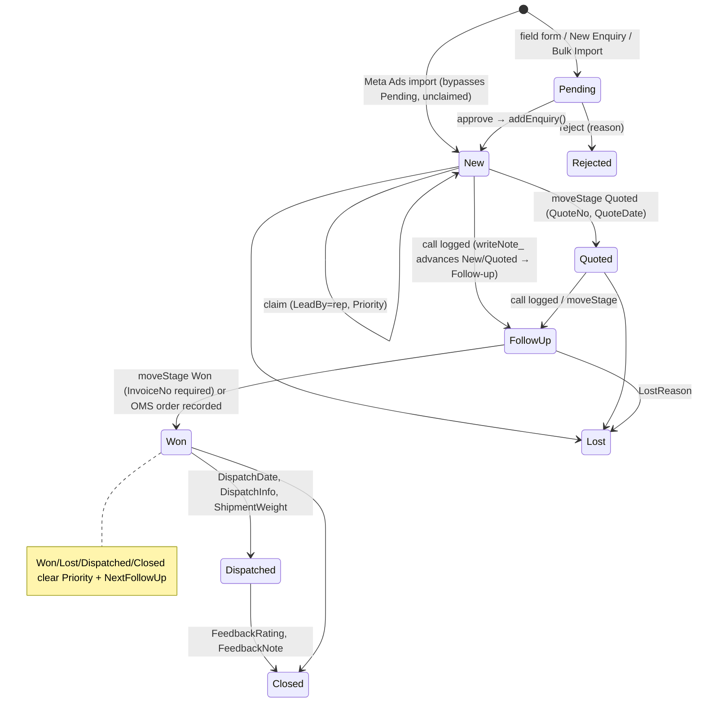

# 05 — Modules and Business Workflows

This describes Deployment A, the current source. **[V]** means traced in code; **[?]** means
not yet confirmed with users.

## Core lifecycle

`moveStage` does not enforce these transitions. **Any stage can be set from any stage**, and the
target value is not validated (BUG-009). The diagram shows the intended flow implied by the UI and
the comments.

## Module catalogue

### 1. Login / session (`app.js`, `Index.html` gates)

- **Purpose:** identify the user and their role.
- **Inputs:** username/password, or the shared Admin PIN. "Forgot password" emails the admin
  (in practice it usually does nothing; see BUG-017).
- **Backend:** `getConfigMeta`, `login`, `checkPin`, `whoAmI`, `requestPasswordReset`.
- **Result:** a token in `localStorage.fms_session`, valid for 6 h (sliding) in CacheService.
- **Failure:** the message "Session expired — please reload…". The client returns to the gate.
- **Pending change (SEC-02, not deployed):** the PIN path stops working once user accounts exist,
  unless `ALLOW_PIN_LOGIN = YES`, and the PIN link is hidden. All sessions end once at deploy
  (cache prefix bump).

### 2. Dashboard (`dashboard.js`, `dashboardCharts.js`)

- **Shows:** total, active pipeline, pipeline value (QuoteAmount ∥ EstValue), won this month and
  won revenue (OrderValue), Hot/Warm/Cold, overdue/today, win rate, the Contacted → Approved →
  Converted funnel, escalations, and charts by month/source/priority/rep/state.
- **Backend:** `getDashboardData(filter)`. Reps are forced to `leadBy = me.name`.
- **Sheets:** Enquiries (cached).
- **Notes:** no code path writes QuoteAmount or OrderValue (BUG-018), so "Won revenue" stays 0
  unless someone fills OrderValue directly in the sheet.

### 3. Follow-ups (`followup.js`)

- **Shows:** open-stage enquiries with a NextFollowUp, grouped Overdue / Today / Upcoming
  (Upcoming is capped at 15). It also builds WhatsApp follow-up links.
- **Backend:** `getFollowUpsDue`, plus `getFollowUpBadgeCounts` for the tab badge.
- **Rule:** cadence comes from `computeNextFollowUp_`. Working days skip Sundays: Hot 1, Warm 2,
  Cold 6. `EXTRA_HOLIDAYS_` is empty.

### 4. Available Leads (`availableLeads.js`)

- **Shows:** open enquiries with a blank LeadBy.
- **Flow:** the rep calls the lead from the modal, picks Priority and call status, then clicks
  Claim. This runs `claimEnquiry(id, priority)` (locked; fails if the lead is already claimed),
  then `logCall`. ClaimedAt is set.
- **Also:** an "Import Meta Ads Leads" button (`importMetaLeadsNow`).

### 5. Pipeline (`pipeline.js`) and Enquiry detail (`modal.js`)

- **Pipeline:** filters on text, stage (single or array), source, rep, priority, follow-up status,
  city, state, company and date range. Reps see only their own leads. Incoming transfers are
  shown with Accept/Decline.
- **Detail:** `getEnquiry` returns the row plus the FollowUps history and the CallLog. The detail
  view supports:
  - edit → `editEnquiry` (owner or admin; overwrites the customer and cascades by phone)
  - stage moves → `moveStage`
  - soft delete → `deleteEnquiry`
  - transfer → `proposeTransfer`
  - WhatsApp welcome/follow-up links
  - an "Order FMS Form" link that opens a **prefilled Google Form** with rep, customer, phone,
    EnqID, location, OrderValue, requirement and notes in the URL
  - the OMS panel
- **Transfer rule:** the owner proposes, `TransferTo` is set, and ownership changes only when the
  target accepts (`acceptTransfer`). Note: `editEnquiry` also accepts `leadBy`, so an owner can
  reassign directly and bypass acceptance (BUG-010, needs a decision).

### 6. Customers (`customer.js`)

- `getCustomers(q)` adds an enquiry count per customer (counted by phone).
- `addCustomer` / `editCustomer`: an edit **cascades** name/company/phone/etc. to every enquiry
  with the old phone.
- Team roster add/remove is admin-only on the server.

### 7. New Enquiry (`newEnquiry.js`) → Pending

- **Validation (client):** name and phone are required. Phone must be 10 digits (an optional
  0/91 prefix is accepted). Email, GST and pincode formats are checked.
- **Autofill:** the pincode fills District/State/Area. A known phone fills customer details
  (`getCustomerByPhone`). A duplicate-phone warning comes from `checkPhoneDuplicate`.
- **Server:** `submitPendingEnquiry`. An optional PDF (≤10 MB) is saved to the Drive folder
  "SETMI INDIA - Enquiry Documents" and **shared anyone-with-link** (SEC-08).
- **Server-side validation:** only name and phone presence. The other formats are not re-checked.

### 8. Public field form (`Enquiry.html`, `?page=enquiry`)

- No login. It calls `submitFieldEnquiry`, which goes to Pending. There is no rate limit or
  CAPTCHA (SEC-07).
- The form shows the duplicate check (`checkPhoneDuplicate`, which returns a count, the last date
  and the last stage).

### 9. Pending Approvals (`pending.js`)

- Lists Pending rows, which can be edited (`updatePendingEnquiry`), approved or rejected.
- **Approve** calls `addEnquiry` with `INTERNAL_BYPASS_`. If no LeadBy was chosen, the lead stays
  unclaimed and appears on Available Leads.
- **Any signed-in user can approve or reject**: there is no admin check (BUG-011, needs a decision).
- `ReviewedBy` comes from `Session.getActiveUser()` and is usually blank (BUG-017).

### 10. Bulk Import (`bulkImport.js`)

- Parses CSV/Excel in the browser (SheetJS 0.18.5). The user maps columns, and
  `submitBulkPendingFromRows` writes a batch of Pending rows (Source defaults to Other, Priority to
  Warm).

### 11. Call Management (`callLog.js`, `CallLog.js`)

- `logCall`: the call number is the count of existing calls + 1. The soft limit is 6, after which
  the UI asks for confirmation. It writes FollowUps and updates the enquiry through `writeNote_`,
  then appends a CallLog row.
- `logCall` checks **no ownership**, and `employee` is taken from the client (SEC-09).
- `getCallDashboard`: today's calls, connected vs missed, and pending calls due.

### 12. Reports (admin; `reports.js`)

- `getReports`: by source and by rep (enquiries, won, lost, win %).
- `generateReportSheet`: deletes and recreates the tab "Report *Mon yyyy*". It is callable by
  **any signed-in user**, not just admins.

### 13. Team Performance (admin)

- `getTeamPerformance`: per name, leads, open, overdue, calls this month/today, follow-ups this
  month, won/lost and win %.

### 14. Users (admin; `users.js`)

- List, add (≥6-character password; the username allows `a-z0-9._-`), activate/deactivate, reset
  password, set role. A user cannot demote themselves.
- Adding a user also adds their name to the Team roster.

### 15. MAP Analytics (`mapAnalytics.js`, `MapAnalytics.js`)

- Places points in this order: pincode centroid (from the `PINCODE_LATLNG_` table), then the
  district (Nominatim, with up to 8 new lookups per load cached permanently in Script Properties),
  then the state centroid.
- Zones are North/South/East/West/Central/Northeast/Islands. "Zone In" means converted and
  "Zone Out" means lost.

### 16. Data Analysis (`analysis.js`, `Analysis.js`)

- One PII-free row per enquiry, filtered and aggregated client-side.
- **Share link** `?page=analysis&key=` gives the same rows with rep, speed, idle and repeat
  blanked. The key is **hardcoded** in source (SEC-04).
- "Customers List" (Won/Dispatched/Closed with name and phone) requires login.

### 17. OMS bridge (`omsOrder.js`, `OmsBridge.js`)

- `recordOrderToOms`: owner or admin; requires at least one item. It POSTs `/api/ingest/order`,
  stores `OMSOrderID` and moves the stage to **Won** (`skipInvoice`).
- `getOmsOrder` shows status and the PI link. `omsMarkPiSent` and `omsRecordPayment` post actions.

### 18. Meta Ads import (`MetaLeadsImport.js`)

- Reads every tab of the external sheet named in `META_LEADS_SHEET_ID`. It matches header aliases,
  strips Meta `p:` / `z:` prefixes and deduplicates on a `MetaLeadID:` tag in Notes (it checks
  **Enquiries + Pending only, not Archive**; BUG-007). It looks up the pincode for district and
  state, then **bulk-inserts straight into Enquiries** (unclaimed, Source = Other). It does not
  create Customers rows.
- It runs from the menu, from the Available Leads button, or from a 30-minute trigger on
  `importNewMetaLeads_` (BUG-008: verify the trigger actually runs).
- Separately, many Pending rows have `SubmittedBy = "Meta Ads auto-import"`. **A second importer
  (the external app [H]) sends Meta leads to Pending instead.** Two paths with different
  behaviour.

### 19. Daily digest

- `sendDailyDigest`: emails the overdue and today lists plus KPIs to `CONFIG.ADMIN_EMAIL` (or the
  active user). The trigger is created by `setupDailyTrigger` (daily, around 09:00 IST).

### 20. Spreadsheet menu "Sales FMS" (owner/editors, inside Sheets)

| Group | Items |
|---|---|
| Setup | Setup/Repair, Recalculate follow-ups, Fix phone formatting, Clear stale priority, Setup daily email |
| Audit | Read-only audit |
| Meta | Set sheet, Import now, Start/Stop auto-import |
| Admin | Change Admin PIN, Add User |
| Data quality | State/pincode quality, Warm district geocoding, Fix state in City/District, State-from-City geocode, Bug-auto-assigned check/fix |
| Data movement | Data counts, temporary reconcile/push/debug tools, Archive/Restore |

## Cross-module dependencies

- **Rep visibility everywhere depends on `Users.Name === Enquiries.LeadBy === CallLog.Employee`.**
  These are exact string matches.
- Every enquiry list depends on `getAllEnquiries_()` and its 90 s cache.
- Intake paths (form, New Enquiry, Bulk) depend on `PendingEnquiries` headers. Approve depends on
  `addEnquiry`.
- Stage Won depends on InvoiceNo, unless the OMS bridge set the stage.

## Unknown workflows

| Item | Needed |
|---|---|
| What the Order FMS Google Form feeds, and who processes it | Form owner |
| Whether QuoteAmount and OrderValue are expected to be typed into the sheet by hand | Sales team |
| Intended rule for rep self-reassignment and rep approval rights | Business owner decision |
| Behaviour of Deployment B (older server code) for its current users, if any | Usage confirmation |
