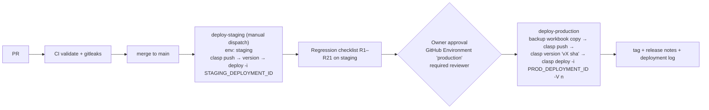

# 12 — CI/CD and Release Process

## Status of each component

| Component | Status |
|---|---|
| CI workflow `.github/workflows/ci.yml` (structure, syntax, secret patterns, unit/contract tests, gitleaks) | **Configured; validated locally** (YAML parses; the four npm checks pass locally). **Not yet run on GitHub** (not pushed) |
| Branch protection with required checks | **Planned** (owner action) |
| Staging environment | **Planned**, not created (see 13) |
| Automated deploy to staging | **Planned**, not configured |
| Production deploy | **Manual, approval-gated. No automation configured.** Production-enabled automation: **none** |

## Continuous integration (`ci.yml`)

- **Triggers:** every PR, pushes to `main`, and manual runs.
- **Permissions:** `contents: read` only.
- **No Google credentials** are used.

| Job | Steps | Fails when |
|---|---|---|
| `validate` | checkout → Node 22 → `check:structure` → `check:syntax` → `check:secrets` → `npm test` | a required file is missing, a file or `<script>` block has a syntax error, a known secret shape is present, or any unit/contract test fails |
| `gitleaks` | full-history checkout → `gitleaks detect` (pinned image v8.18.4, redacted output) | any secret found in history |

**What CI does not prove:** that the code works against real Sheets. That needs the staging
checklist. There are no lint or format tools yet. Adding ESLint with Apps Script globals is a
reasonable next step, but it would flag existing style issues and needs a baseline decision first.

## Continuous delivery design (proposed; not implemented)

### Facts that shape the design [V/H]

- `clasp push` replaces the script's **HEAD** files. Versioned web-app deployments (`/exec`) keep
  serving their pinned version until `clasp deploy -i <deploymentId> -V <version>` re-points
  them.
- **But HEAD runs immediately for anything that is not a versioned deployment:**
  - the spreadsheet menu (`onOpen`) and every menu tool
  - installable **time-driven triggers** (daily digest, Meta import)
  - the `/dev` test URL

  A push to the production script is therefore a production change, even before any deploy.
- The Apps Script API does not accept service-account credentials, so automation needs a **user
  OAuth credential** (`.clasprc.json`) for an account with edit access to the target script.

### Pipeline



### Secrets (GitHub Environments, never in the repo)

| Secret | Environment | Contents |
|---|---|---|
| `CLASPRC_JSON` | staging / production (separate values) | OAuth refresh token of a **dedicated deploy account** with edit access to that script only |
| `SCRIPT_ID` | per environment | target script ID |
| `DEPLOYMENT_ID` | per environment | the existing `/exec` deployment to re-point (keeps the URL stable) |

Least privilege:
- The deploy account should not own the workbook and should not have Gmail or Drive data beyond
  what deployment needs.
- The production environment requires the owner's approval and only allows deployments from `main`.

### Release procedure (manual, until automation is approved)

1. Merge the PR to `main` (CI green).
2. **Back up:** File → Make a copy of the production workbook (owner-only folder). Note the
   current production version number from Manage deployments.
3. Push to staging, deploy, and run the regression checklist.
4. **Approval:** the owner signs off in the PR or release.
5. Production: `clasp push` (HEAD), `clasp version "v2026.10.28-1 <sha>"`, then
   `clasp deploy -i <PROD_DEPLOYMENT_ID> -V <n> -d "v2026.10.28-1"`.
6. Smoke test R1, R2, R9 and R17 on production with a test lead, then mark it deleted.
7. Tag the git commit and write release notes (version number, deployment ID, tester, results).

### Rollback

- **Web app:**
  ```
  clasp deploy -i <PROD_DEPLOYMENT_ID> -V <previous n>
  ```
  Or in the editor: Manage deployments → Edit → Version = previous. The URL is unchanged.
- **Menu and triggers (HEAD):**
  ```
  git checkout <previous tag> -- src && clasp push
  ```
- **Data:** restore the affected ranges from the pre-release copy or from Version history.
  Schema changes (new headers) are additive, so leave them in place.
- Record the rollback in the release notes, and open a BUG entry.

### Deployment log

Each release records: date and time, operator, git SHA and tag, Apps Script version number,
deployment ID, staging results, approver, and smoke-test result. Keep this in GitHub Releases.
