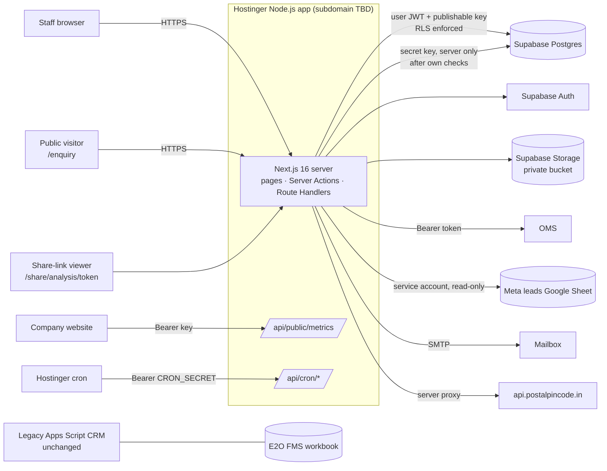
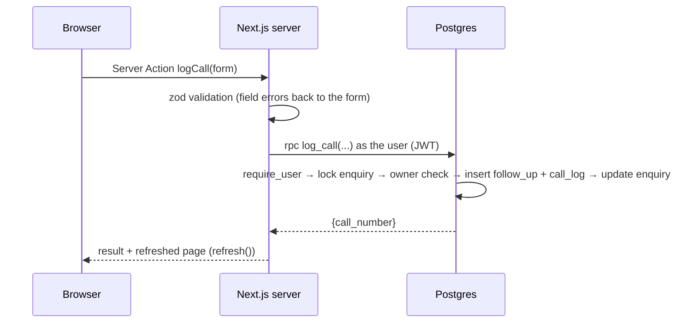

# New CRM — Architecture

The modernized CRM lives in **`web/`** (Next.js) and **`supabase/`** (PostgreSQL migrations). The
legacy Apps Script app stays untouched in **`src/`** and keeps running at its existing URL (ADR-0001).

## System context

## Layers

| Layer | Where | Responsibility |
|---|---|---|
| UI | `web/src/app/**`, `web/src/components/**` | Server Components render data; small Client Components handle forms, the map and the analysis explorer. No business rules in components. |
| Server Actions / Route Handlers | `web/src/server/actions/*`, `web/src/app/api/**` | Validate input (zod), rate-limit public calls, call the database, map errors. CSRF: Server Actions are origin-checked by Next. |
| Data Access Layer | `web/src/server/auth.ts`, `queries.ts`, `rpc.ts` | Verify the session (`getClaims`), load the profile, run RLS-scoped reads. |
| Domain library | `web/src/lib/domain/*` | Pure, unit-tested helpers: dates (IST), grading, validation, geo, products, imports, CSV. |
| Integrations | `web/src/integrations/*` | OMS adapter, Google Sheets reader, SMTP. Typed errors, timeouts. |
| **Business logic + authorization** | `supabase/migrations/*` | Transactional `SECURITY DEFINER` functions; RLS on every table; constraints. |

### Why business rules live in Postgres functions

Every multi-step operation (claim, approve, log a call, move a stage, record an OMS order) must be
atomic and race-free. Doing it inside one SQL function gives one transaction with row locks
(`SELECT … FOR UPDATE`), and the same rules apply whether the call comes through the Next.js server
or directly through the Supabase Data API with a user token. Clients have **no** direct
insert/update/delete grants (ADR-0003).

## Request flows

Public intake: `/enquiry` → Server Action `submitPublicEnquiry` → honeypot + zod + per-IP limit →
`submit_public_enquiry` with the **secret key** (function is granted to `service_role` only and accepts
only allow-listed fields) → row in Pending Approvals.

## Authentication and sessions

Supabase Auth (email + password, optional TOTP MFA). Session cookies are set by `@supabase/ssr`;
`src/proxy.ts` refreshes them and redirects signed-out users. Every page re-verifies with
`getClaims()` and loads the profile; deactivated profiles resolve to "not signed in" and RLS blocks
their data. Username *or* email can be used to sign in.

## Rendering and caching

All pages render per request (cookies, nonce CSP). Cache Components are **off** (ADR-0002). Lists are
paginated server-side; KPIs and charts are aggregated in SQL.

## Coexistence with the legacy app

The two systems use **separate databases**. There is no dual-write. The legacy app remains the
system of record until a migration rehearsal passes and the owner approves cutover
(DATA_MIGRATION.md).
