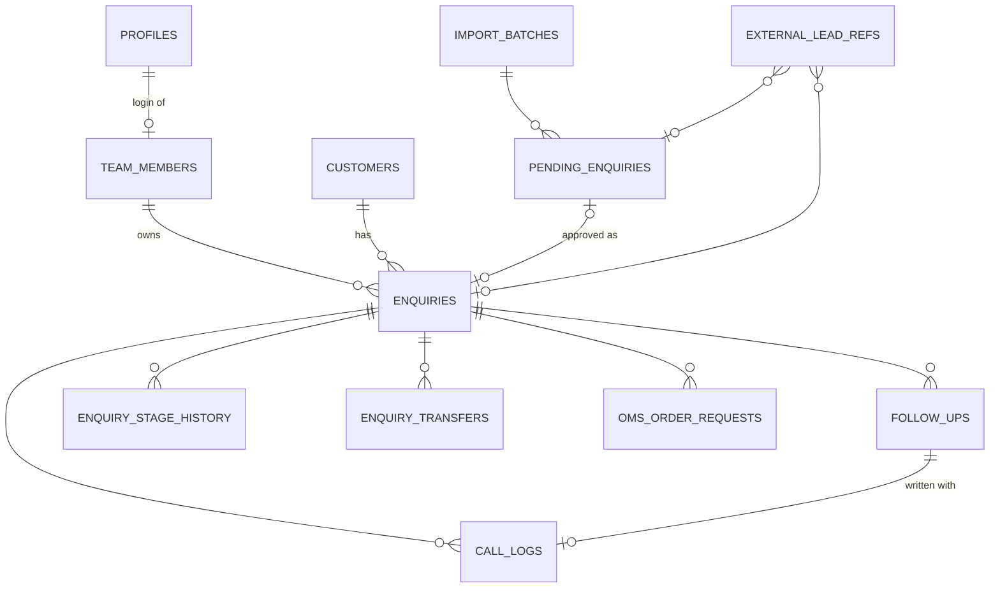

# Database schema (Supabase Postgres 17)

Source of truth: `supabase/migrations/*.sql` (applied in file-name order) and
`supabase/seed/01_reference.sql` (generated by `web/scripts/generate-reference-data.mjs`).

| Migration | Contents |
|---|---|
| `…0100_foundation` | schemas `extensions`, `private`; code counters; lead sources, states, pincodes, holidays, settings; profiles, team_members |
| `…0200_crm_tables` | customers, enquiries, stage history, import batches, pending, external refs, follow-ups, call logs, transfers, OMS requests, audit log, share links, API keys, job runs, rate limits |
| `…0300_domain_functions` | business rules (working days, cadence, grade, status, transitions), auth helpers, audit, rate limiter, customer upsert |
| `…0400_rpc_intake_and_pipeline` | intake, approvals, claim/transfer, edit, stage moves, calls, notes, delete/restore, archive |
| `…0500_rpc_admin_and_integrations` | customers, team/users, settings, holidays, share links, metrics key, Meta import, OMS two-phase, jobs, audit |
| `…0550_rpc_queries` | dashboard, available leads, follow-ups due, call dashboard, reports, team performance, customers list, analysis, map, public metrics, digest |
| `…0600_security` | grants, RLS policies, function EXECUTE allow-list, private storage bucket |

## Entity relationships

## Core tables

### `enquiries`
Business key `enq_code` (`SETMI-ENQ-0001`, unique, never wraps). Dates: `enq_date`, `quote_date`,
`next_follow_up`, `last_contact`, `dispatch_date` are **IST business dates** (`date`); `created_at`,
`claimed_at`, `updated_at`, `archived_at` are instants (`timestamptz`).

| Constraint | Rule |
|---|---|
| `stage` CHECK | New, Quoted, Follow-up, Won, Lost, Dispatched, Closed |
| `enquiries_terminal_clears_followup` | closed-out stages have no priority / next follow-up |
| `priority`, `timeline`, `grade`, `escalation` CHECKs | legacy vocabularies |
| `source` FK → `lead_sources` | |
| `owner_id` FK → `team_members` (RESTRICT) | ownership by roster id, not by name text |
| `customer_id` FK → `customers` (RESTRICT) | |
| `oms_order_id` UNIQUE | one OMS order per enquiry |
| `version` | optimistic concurrency for edits/stage moves |
| soft delete `active=false`; archive `archived_at` | no hard deletes of business records |

Indexes: owner+stage, stage, next_follow_up (open only), enq_date, source, phone_key, customer,
unclaimed, trigram search.

### `pending_enquiries`
`status` Pending/Approved/Rejected with CHECK `pending_review_complete` (approved ⇒ enquiry id +
reviewed_at; rejected ⇒ reviewed_at + reason). `approved_enquiry_id` UNIQUE (one enquiry per
approval). `idempotency_key` UNIQUE (public form retries). `possible_duplicate` flag. Stores Qty and
Timeline (BUG-006) and the submitter id + name (BUG-017).

### `call_logs` / `follow_ups`
Unique codes; `(enquiry_id, call_number)` UNIQUE; `interest` only when Connected (CHECK);
`client_request_id` UNIQUE for idempotent submits; `follow_up_id` links the follow-up written in the
same transaction.

### `customers`
`phone_key` (generated: last 10 digits) UNIQUE among active rows.

### Other
`enquiry_transfers` (one open transfer per enquiry), `enquiry_stage_history`,
`oms_order_requests` (one started/succeeded per enquiry), `external_lead_refs` (PK source+external id
= dedup), `import_batches`, `profiles`, `team_members`, reference tables. Private schema:
`audit_log`, `share_links` and `api_keys` (SHA-256 hashes only), `job_runs`, `rate_limits`,
`app_settings`, `id_counters`.

## RLS summary

| Table | authenticated SELECT | writes |
|---|---|---|
| enquiries | admin: all · rep: own + leads with a transfer offered to them | RPC only |
| follow_ups, call_logs, stage history, OMS requests | rows of enquiries the user can see | RPC only |
| customers | admin: all · rep: customers of own leads | RPC only |
| pending_enquiries | admin: all · others: own submissions | RPC only |
| enquiry_transfers | the two parties + admin | RPC only |
| profiles | self + admin | server (Auth admin) |
| team_members, lead_sources, states, pincodes, holidays | active users | admin RPC |
| import_batches | admin + creator | RPC |
| external_lead_refs, private.* | none | RPC / server |

`anon` has no table or function access at all. Full matrix: SECURITY.md.
